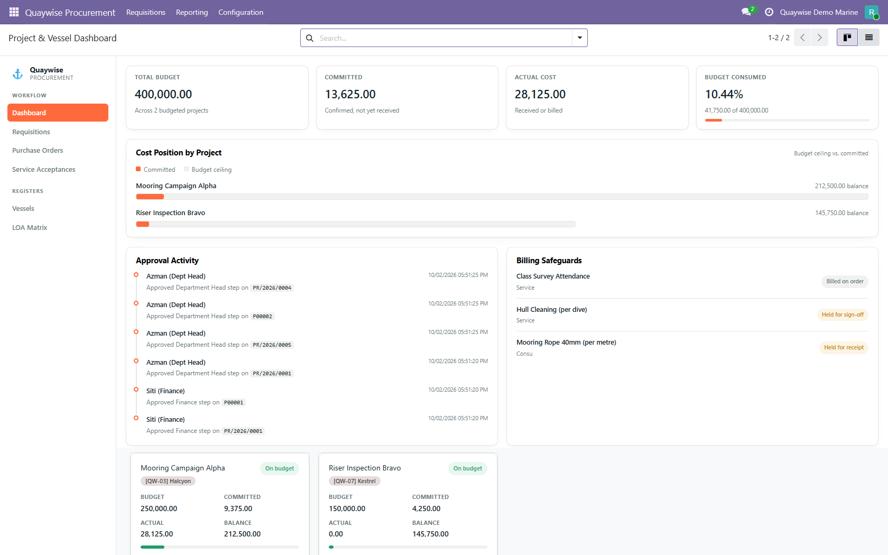
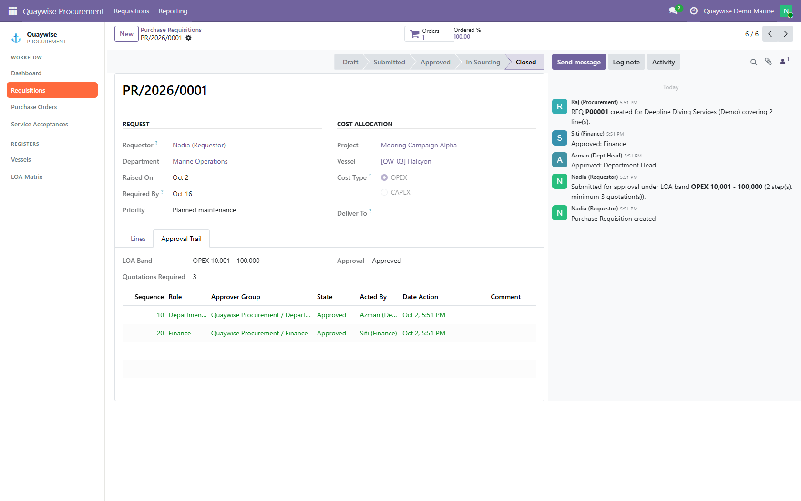
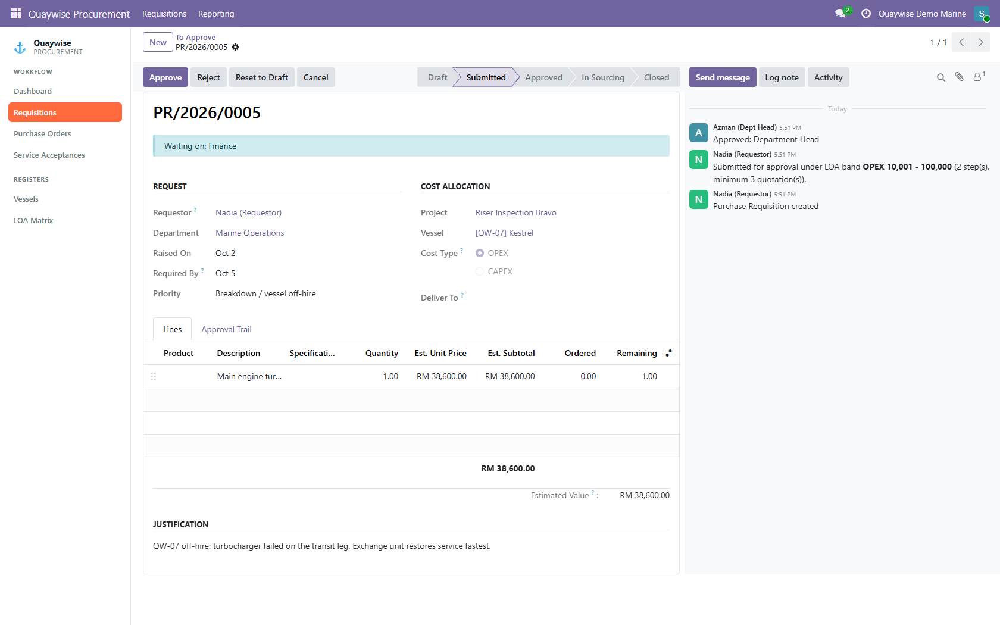
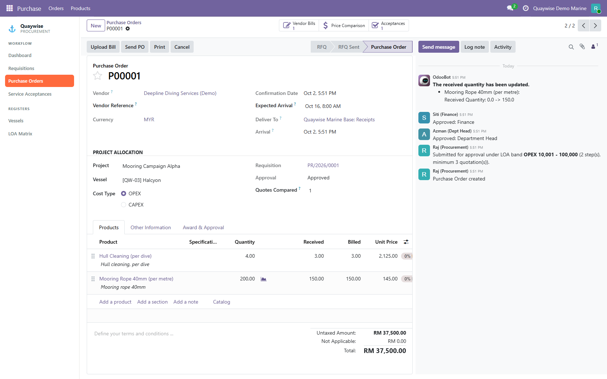
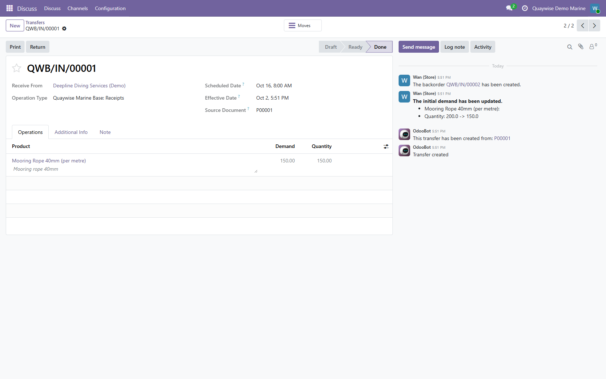
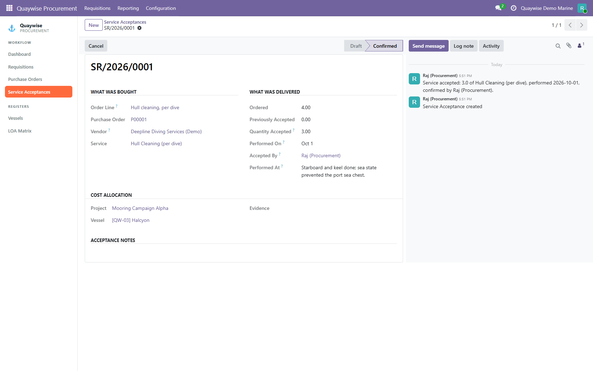
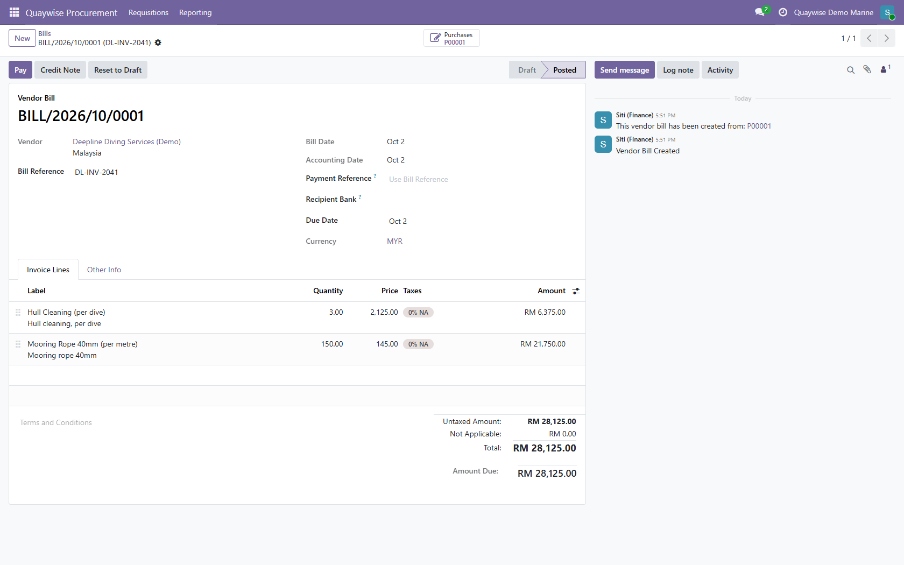
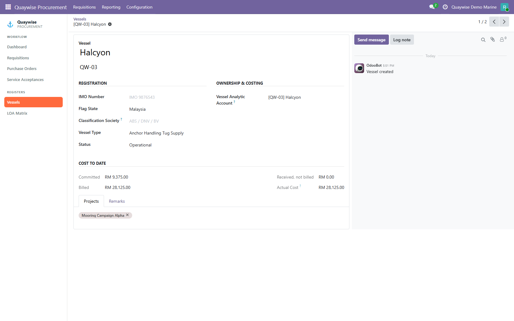
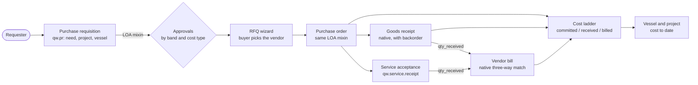

# ⚓ Marine Procurement & Approval System (Odoo 19)

> A custom Odoo 19 module that takes an offshore marine operator from **"we need hull cleaning on vessel QW-03"** to **"the bill matches what was actually done"**, with every approval signed by the right person for the amount.

**Status:** Private repository. Source code available on request (interviews, review, collaboration).

**Walkthrough video:** on my portfolio, <https://www.anwarhadif-portfolio.com/#projects> (featured project #2).

Built as a working pitch prototype for an offshore marine operator. Every company, person, vessel and vendor shown here is fictional ("Quaywise").

---

## What it does

Standard Odoo handles receipts, bills and payments well. Testing a live Odoo 19 database against the operator's ten-step workflow found four gaps, and the module closes exactly those:

1. **Purchase requisitions.** A requester states the need, the project and the vessel. There is deliberately no vendor field: picking the supplier is procurement's job, later.
2. **A limits-of-authority (LOA) matrix.** Bands by amount and by OPEX/CAPEX decide who must sign, in order. An OPEX request between RM 10,000 and RM 100,000 needs the Department Head *and* Finance. The same matrix gates the purchase order, so an order cannot be confirmed before it is approved.
3. **Service acceptance.** Goods are checked on receipt; services were not. Hull-cleaning dives can now only be billed once someone confirms they were performed (1 of 2 dives done means 1 dive billable).
4. **A vessel register with cost to date.** Committed, received-not-billed and billed cost per vessel and per project, on a custom dashboard.

---

## Screenshots

| | |
|---|---|
|  **Spend per project and vessel at a glance** |  **Two-step approval, every decision logged** |
|  **Bigger requests wait for Finance** |  **Purchase order raised from the request** |
|  **Partial delivery, backorder for the rest** |  **Services accepted only for work done** |
|  **Bill matches what was received** |  **Running cost per vessel** |

---

## Tech stack

- **Odoo 19 Community**, custom module `quaywise_procurement`
- **Python** models, wizards and access rules; **XML** views
- **OWL (Odoo Web Library) / JavaScript** for the dashboard views
- **PostgreSQL**, **Docker Compose** for the demo environment
- **Playwright** scripts that recorded the walkthrough as five separate logged-in users

---

## Architecture

---

## Key engineering details

- **Scope was set by testing, not assumption.** Committed cost against budget, vessel cost on every document, three-way match on goods and backorders all turned out to be native. They were removed from scope instead of rebuilt.
- **One approval engine for two documents.** The LOA logic is a mixin used by both the requisition and the purchase order, so the matrix is defined once and the two can never disagree.
- **Services plug into Odoo's own matching.** Rather than a parallel check, service acceptance extends `qty_received_method`, so confirming a dive drives `qty_received`. Odoo's native three-way match, "Should Be Paid" indicator and bill auto-completion then work for services with no further changes.
- **The cost ladder never double-counts.** An order line is *committed* until received, then *received-not-billed* until a bill is **posted**, then *billed*. A bug where a draft bill made received goods vanish from actual cost was found while recording the demo and fixed with a regression check covering draft, posted and refunded bills.
- **Tested as five real roles.** The demo data is seeded by running every workflow step as the user who owns it (requester, department head, finance, buyer, store), so the approval trail and chatter show separate people.

---

## Interested in the code?

The repository is private. If you would like to see the source, the LOA engine or the service-acceptance design, feel free to reach out.
